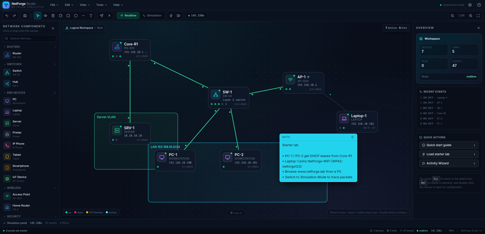

# NetForge Studio

NetForge Studio is a modern, browser-based network simulation and learning environment inspired by classic desktop network trainers. It uses an unbranded device set and a purpose-built discrete-event simulation engine, so you can build topologies, configure devices through an IOS-style CLI or graphical tools, and watch packets move through the network in real time or step by step.

Built with React 19, TypeScript, Vite, Tailwind CSS, Zustand and a dependency-free simulation core.



## Quick start

```bash
npm install
npm run dev      # http://localhost:5173
npm run build    # type-check + production bundle
npm test         # run the simulation engine regression suite
```

Open the app, choose **Load example lab** on the empty workspace (or from **File**), then double-click a device to configure it. Use **File → New workspace** to start from scratch.

## Docker deployment

The app is a static single-page bundle, so the image is built in two stages: Node builds the bundle, then nginx serves it.

```bash
docker compose up -d --build     # http://localhost:5173
docker compose down              # stop and remove the container
```

Without Compose:

```bash
docker build -t netforge-studio .
docker run -d --name netforge-studio -p 5173:80 netforge-studio
```

The nginx config in [deploy/nginx.conf](deploy/nginx.conf) adds SPA history fallback, gzip, security headers, and long-lived caching for the content-hashed assets in `/assets/`; `index.html` is always revalidated.

## Workspace and editing

- **Logical workspace** with pan, wheel zoom, fit-to-screen, marquee selection, multi-device drag, grid, snapping and alignment guides.
- **Device palette** grouped into routers, switches, end devices, wireless, security and WAN equipment. A picked device stays armed so you can place several in a row; press Esc, right-click the workspace or click the palette entry again to stop. Dragging a device onto the canvas places that one device and does not stay armed.
- **Cabling tool** with automatic port filtering, straight-through, crossover, serial (DCE/DTE), console, phone, coax and fiber cables. Cable ends are validated: straight-through pairs unlike ports (host ↔ switch), cross-over pairs like ports (PC ↔ PC, switch ↔ switch, router ↔ router), and a mismatched pair is refused. A chosen cable type stays armed for connecting several links in a row; Esc or right-click finishes. Dragging a cable onto a device starts a single link and disarms once it is created; dropping a cable on empty workspace does nothing. Link lights show physical state, activity and STP blocking.
- **Notes, shapes and free text** for annotating topologies. The Text tool adds a draggable label; double-click any shape to edit its text, drag to move it, drag its handles to resize it, and press Delete or use the right-click menu to remove it. Select a shape to change its color, stroke width and label in the inspector.
- **Undo/redo, copy/duplicate, delete, import/export JSON**, browser autosave and manual save.
- **Physical configuration** for modules, power, interface LEDs and cable selection.
- **Inspector** for the selected device or link, including runtime neighbors, interface state and port details.
- **Dark and light themes**: the sun/moon button next to the settings gear in the header switches themes; the choice is saved with the rest of the workspace preferences.
- Responsive layout: collapsible palette, collapsible inspector, and a full-width simulation panel.

## Devices

One model per category keeps the palette simple while preserving the behavior that matters:

| Category | Device | Highlights |
| --- | --- | --- |
| Router | Router | Multiple Ethernet ports, serial WAN modules, static/RIP/OSPF/EIGRP routing, DHCP, NAT and ACLs |
| Switch | Switch | 24 access ports, VLANs, 802.1Q trunks, STP, SVIs and Layer 3 switching |
| Switch | Hub | Shared-segment flooding |
| End devices | PC, Laptop, Server, Printer, Phone, Tablet, Smartphone, IoT | Desktop apps, services, wireless clients |
| Wireless | Access point, Home router | SSID/security, associations, home NAT, DHCP, port forwarding, admin UI |
| Security | Firewall | Inside/outside/DMZ zones, security levels, stateful return traffic, ACLs |
| WAN | Cloud, Modem | Transparent WAN transport across Ethernet, serial, coax and phone links |

## Configuration and CLI

Double-click a device to open its window:

- **Physical** — power, modules, port LEDs and cable management.
- **Config** — hostname, interface addressing, VLANs, gateway, DNS, routing, NAT, ACLs, DHCP pools and services in forms.
- **CLI** — an IOS-style modal CLI with `enable`, `configure terminal`, interface/line/router modes, abbreviations, `?` context help, tab completion and common `show`/`debug` commands.
- **Desktop** — IP configuration, command prompt, web browser, email, FTP, wireless client, traffic generator and terminal.
- **Services** — HTTP/HTTPS pages, DNS records, DHCP, TFTP, email accounts, FTP files, NTP and syslog.
- **Attributes** — device metadata and runtime information.

Supported CLI areas include interface configuration, VLAN and trunk configuration, SVI creation, static routes, RIP, OSPF, EIGRP, DHCP pools, NAT, ACLs, line/VTY settings, SSH, and verification commands (`show ip interface brief`, `show ip route`, `show vlan brief`, `show spanning-tree`, `show running-config`, etc.).

See [doc/acl.md](doc/acl.md) for a walkthrough of access control lists: where they are evaluated, the GUI and CLI workflow, worked examples for standard/extended/named lists, NAT and firewall policies, and the current limitations.

## Simulation

- **Realtime mode** for immediate end-to-end application traffic.
- **Simulation mode** with an event list, protocol filters, scenario descriptions, packet capture/forward, auto-play, back-stepping, reset and fast-forward.
- **Simple and complex PDUs** with source/destination selection, protocol choice, size, TTL and optional periodic generation.
- **PDU details** across OSI layers: frame headers, ARP/ICMP/TCP/UDP fields, device path, ingress/egress interfaces and outcome.
- **Packet animation** along links with protocol coloring and link activity.

## Protocols and services

- Ethernet switching, MAC learning, flooding, VLANs, 802.1Q trunks, native VLANs and STP.
- IPv4 addressing, subnet masks, ARP, ICMP, default gateways and static routes.
- RIP v1/v2, OSPF and EIGRP with per-interface network statements and passive interfaces.
- DHCP server, relay (`ip helper-address`) and clients; DNS; HTTP/HTTPS; SMTP/POP3 email; FTP; TFTP; NTP and syslog.
- NAT/PAT, static NAT/port forwarding, standard/extended ACLs and stateful firewall zones.
- Open/WPA2 wireless with SSID and key validation, home-router DHCP/NAT and web administration.
- SSH/Telnet, console access and an in-simulator terminal.

## Activities

The **Activity Wizard** turns a topology into a graded exercise: add checks for connectivity, interface addressing, VLANs, routes, services and configuration values, save the activity, then run **Check activity** to see per-check results and a score. Assessments are stored with the topology.

## Architecture

```
src/
  sim/            discrete-event engine, routing/L2 graph, assessment, regression tests
  cli/            IOS-style command session and parser
  data/           device catalog, modules, factory defaults
  lib/            IPv4/MAC helpers and view utilities
  store.ts        Zustand app state, persistence, undo/redo, simulation controls
  ui/             workspace, palette, inspector, dialogs, device tabs, desktop apps
  types.ts        shared device, topology, packet and simulation types
```

The `Simulator` owns device state and a time-ordered event queue. Frames are forwarded through L2 segments and L3 routes; ARP, DHCP, DNS, TCP/UDP application flows and routing protocols are modeled as events. In simulation mode the engine snapshots runtime, queue and log positions so the timeline can move backward and forward. Application-level helpers (`ping`, browser requests, email, FTP, CLI actions) drain the queue when invoked from realtime apps.

## Parity notes and boundaries

The goal is broad functional parity with desktop network trainers, not a byte-for-byte clone. Current boundaries:

- No physical workspace with cities/buildings/wiring closets, clustering, or multiuser sessions.
- No scripting/IoT programming APIs, code editor, or game-style challenges.
- IPv4 is the primary routed protocol; IPv6 is represented as interface metadata but not fully routed.
- Router-on-a-stick subinterfaces are not modeled; use a Layer 3 switch with SVIs for inter-VLAN routing.
- Simplified protocol internals: no full TCP state machine/timers, no OSPF LSA flooding/areas beyond basic area tagging, no PPPoE/VPN/IPsec, no WLC or controller-based wireless.
- STP is a simplified root/port-role calculation without timer-based convergence.
- Firewall security levels are stateful for established flows and use ACLs for refinement; advanced inspection/NAT policies are out of scope.

## License

No license has been declared for this project. Add one before distributing.
